<div align="center">

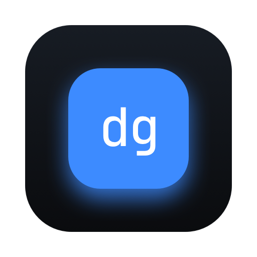

# Digby

**A native macOS app for the open-source [Mole](https://github.com/tw93/mole) CLI.**
Clean caches, remove apps with their leftovers, and see what fills your disk, all with a review step before anything is touched.


[](LICENSE)
[](https://github.com/muhghazaliakbar/digby/actions/workflows/ci.yml)

[Features](#features) · [Install](#2-install-digby) · [Getting started](#getting-started) · [How it works](#how-it-works) · [Safety](#safety) · [Development](#development) · [Support](#support)

<br>

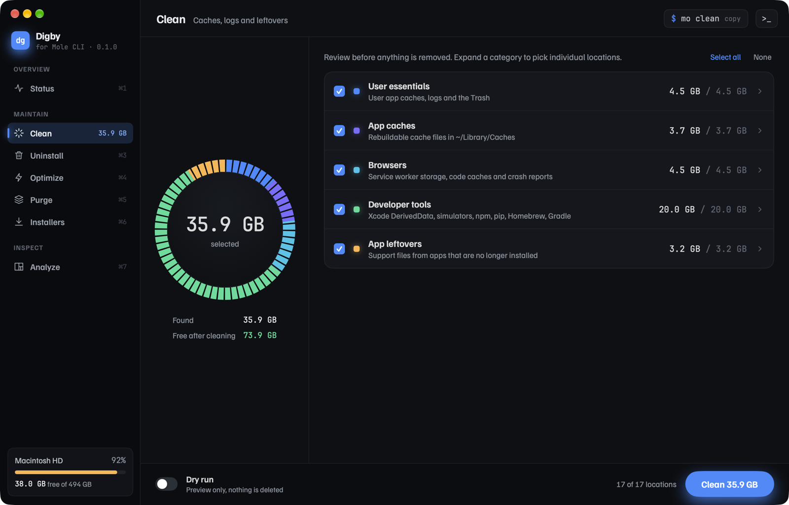

</div>

> [!NOTE]
> Digby is an independent GUI for the open-source Mole CLI by [tw93](https://github.com/tw93). It is not affiliated with Mole or mole.fit.

## Why Digby

Mole is a great terminal tool. Digby puts the same engine behind a native window, for when you want to see what will happen before it happens.

- **Review first.** Every destructive action starts with a scan and a review screen. Nothing is removed until you click a button that states the size, like **Clean 35.9 GB**.
- **Dry run built in.** One switch turns any clean into a preview (`mo clean --dry-run`).
- **Recoverable.** Uninstall, Purge, Installers and Analyze move items to the Trash, never `rm`.
- **Nothing hidden.** Every screen shows its `mo` command (click to copy), and every action streams Mole's raw output into a terminal drawer (⌘J).
- **Native and light.** SwiftUI with Core Animation effects, so Digby idles near 0% CPU.

## Features

| Module | Mole command | What you get |
|---|---|---|
| **Status** | `mo status` | Live health score, per-core CPU, memory, disk, network, battery and top processes, refreshed every second |
| **Clean** | `mo clean` | Caches, logs and leftovers grouped by category, with per-location checkboxes and a dry-run toggle |
| **Uninstall** | `mo uninstall` | Every app with its real icon, last-opened date and leftovers (caches, prefs, containers, launch items) |
| **Optimize** | `mo optimize` | Mole's 20 maintenance tasks, run in one pass with live progress per task |
| **Purge** | `mo purge` | `node_modules`, `target`, `.venv` and other build artifacts. Projects touched in the last 7 days stay unchecked |
| **Installers** | `mo installer` | Leftover `.dmg`, `.pkg`, `.iso` and `.xip` files from Downloads, Desktop and Homebrew caches |
| **Analyze** | `mo analyze` | A zoomable treemap of any folder, with move-to-Trash right from the list |

### Screenshots

<table>
  <tr>
    <td width="50%">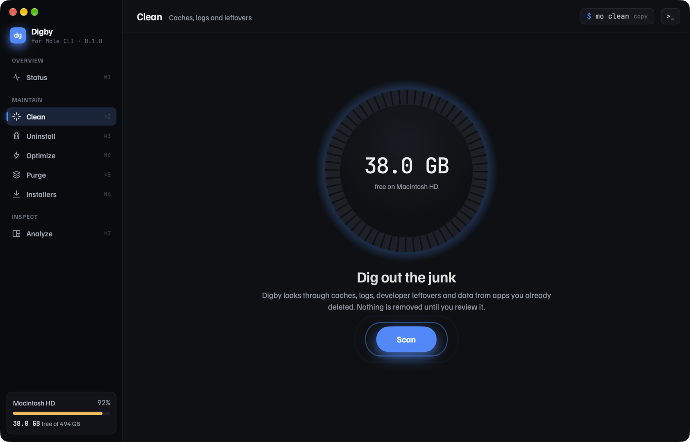<br><sub><b>Clean</b>: start a scan</sub></td>
    <td width="50%">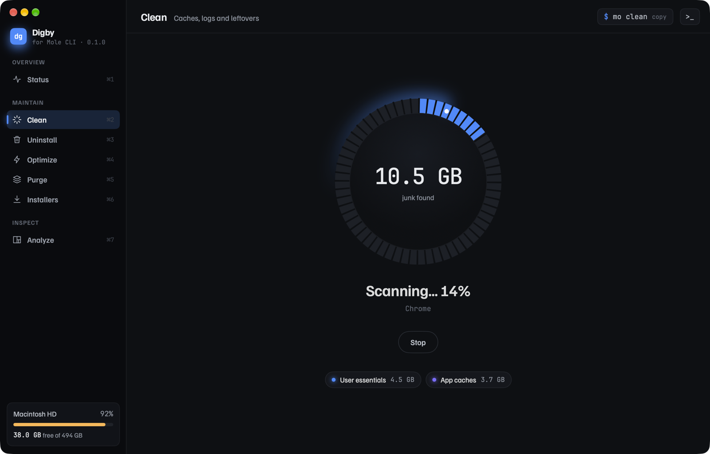<br><sub><b>Clean</b>: categories appear as Mole finds them</sub></td>
  </tr>
  <tr>
    <td>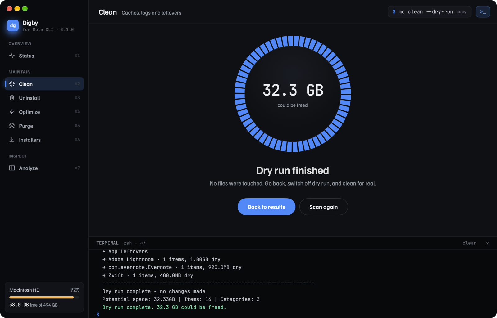<br><sub><b>Clean</b>: dry-run result and Mole's raw output</sub></td>
    <td>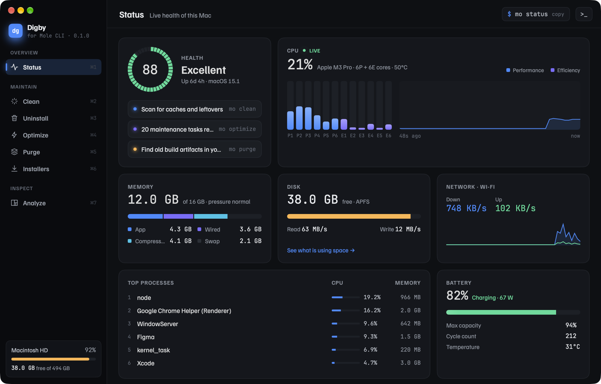<br><sub><b>Status</b>: live system health</sub></td>
  </tr>
  <tr>
    <td>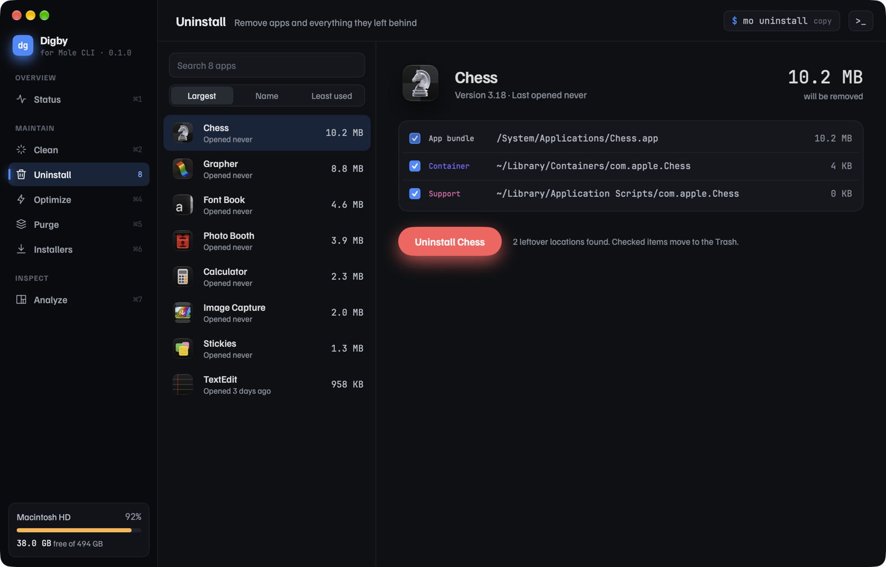<br><sub><b>Uninstall</b>: the app and everything it left behind</sub></td>
    <td>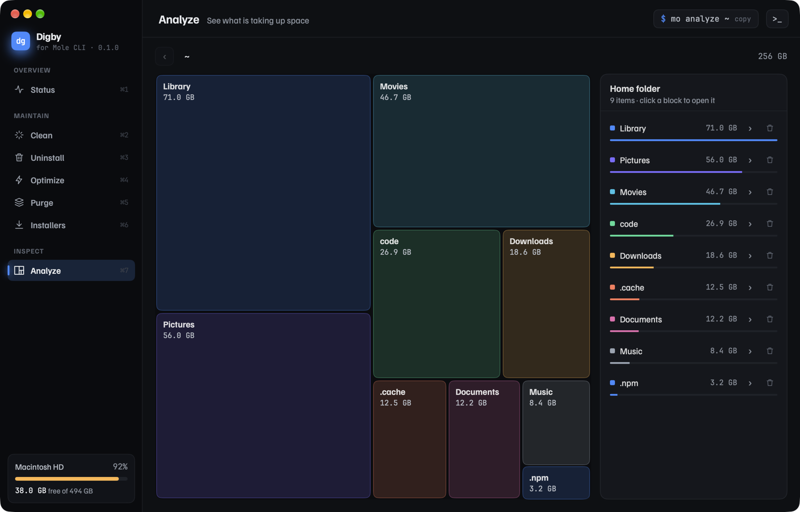<br><sub><b>Analyze</b>: click a block to zoom in</sub></td>
  </tr>
  <tr>
    <td>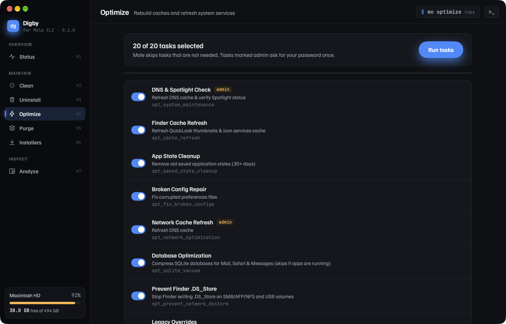<br><sub><b>Optimize</b>: Mole's maintenance tasks</sub></td>
    <td align="center">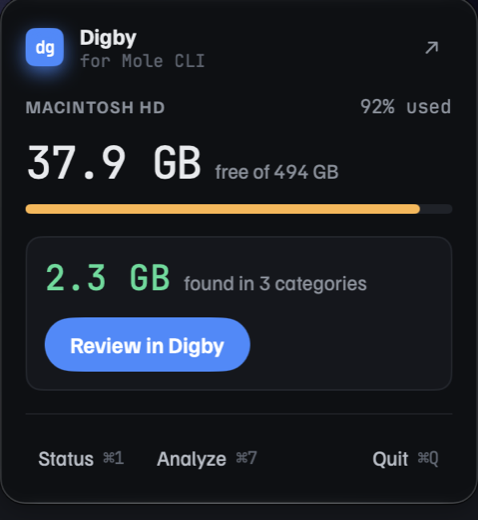<br><sub><b>Menu bar</b>: free space and Quick clean</sub></td>
  </tr>
</table>

<sub>Screenshots use the demo data in <code>DigbyUITests/</code>, not a real Mac.</sub>

### Menu bar

Digby also lives in the menu bar. The status item shows free space, and its panel offers **Quick clean (dry run)**, which runs `mo clean --dry-run` and opens the results in the Clean review with one click. Turn it off, or hide the free-space text, from the **View** menu (*Show in Menu Bar*, *Show Free Space in Menu Bar*).

### Keyboard

| Keys | Action |
|---|---|
| ⌘1 – ⌘7 | Switch modules |
| ⌘J | Toggle the terminal drawer |
| ⌘R | Rescan the current module |
| Esc | Cancel the running job |

## Getting started

### Requirements

- macOS 14 Sonoma or later, on Apple Silicon or Intel
- [Mole](https://github.com/tw93/mole) 1.59 or later

### 1. Install Mole

```bash
brew install mole
```

No Homebrew? Use the install script from [Mole's README](https://github.com/tw93/mole#readme). If Digby can't find `mo`, it opens on a setup screen with both commands and a **Locate binary…** button.

### 2. Install Digby

With [Homebrew](https://brew.sh) (installs Mole too, if you skipped step 1):

```bash
brew install --cask muhghazaliakbar/tap/digby
```

Or download **`Digby-x.y.z.dmg`** from the [latest release](https://github.com/muhghazaliakbar/digby/releases/latest), open it, and drag **Digby** into **Applications**. It is a universal app for Apple Silicon and Intel.

> [!IMPORTANT]
> Digby is not notarized by Apple yet, so the first launch is blocked with *"Apple could not verify Digby…"*. To allow it once:
> 1. Open Digby and close the warning.
> 2. Go to **System Settings → Privacy & Security**, scroll down, and click **Open Anyway** next to Digby.
>
> Or run `xattr -dr com.apple.quarantine /Applications/Digby.app` in Terminal. Each release lists SHA-256 checksums so you can verify the download.

### Or build from source

Requires Xcode 16 or later.

```bash
git clone https://github.com/muhghazaliakbar/digby.git
```

```bash
open digby/Digby.xcodeproj
```

Press ⌘R in Xcode. To build from the command line instead:

```bash
xcodebuild -project Digby.xcodeproj -scheme Digby -configuration Release build
```

## How it works

Digby never reimplements Mole's cleaning logic. It runs the `mo` binary, reads its output, and turns it into UI.

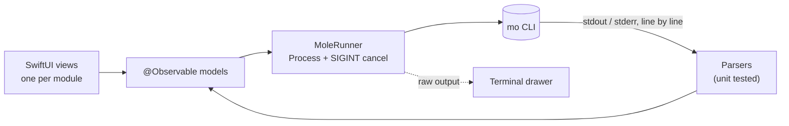

- **JSON where Mole offers it**: `mo status --watch` / `--json`, `mo analyze --json`, `mo uninstall --list`.
- **Text parsers elsewhere**: `mo clean`, `mo purge`, `mo installer` and `mo optimize` output, each covered by unit tests.
- **Where the CLI has no option for what the design needs**, Digby fills the gap and says so. Example: `mo clean` has no per-path selection, so unchecked rows are added to Mole's whitelist for one run and the file is restored afterwards.

Every command and flag Digby relies on, plus each gap it fills, is listed in [NOTES.md](NOTES.md).

## Safety

- Every destructive action has a scan and a review screen first, and the final button always shows the size.
- **Dry run** is a first-class toggle on Clean.
- Removals go to the **Trash** so they can be undone; uninstalling a running app is refused.
- Admin tasks are elevated by Mole itself through the macOS password dialog. Digby never sees or stores your password.
- Digby is not sandboxed, because it has to run `mo` and read the folders Mole scans.

## Development

### Project layout

```
Digby/
  App/          Entry point, window chrome, sidebar, header, terminal drawer, menu bar, theme tokens
  Core/         MoleRunner, parsers, terminal log, disk info, Trash and whitelist helpers
  Components/   Rings, cards, controls, Core Animation loop effects
  Features/     One model and view per module
  Resources/    Familjen Grotesk and JetBrains Mono (SIL OFL)
DigbyTests/     Parser and helper unit tests (Swift Testing)
DigbyUITests/   UI tests, plus the fake mo they run against
digby-handoff/  Design brief and the interactive HTML reference
docs/           README images
scripts/        Release packaging and the icon generator
.github/        CI and release workflows
```

### Releases

Releases are built by GitHub Actions. Bump `MARKETING_VERSION` in the Xcode project, commit, then push a matching tag:

```bash
git tag v0.2.0 && git push origin v0.2.0
```

The [Release workflow](.github/workflows/release.yml) builds a universal app, packages `Digby-<version>.dmg`, a `.zip` and `SHA256SUMS.txt`, and publishes them as a GitHub release with install notes and a changelog. Running the workflow by hand (Actions → Release → Run workflow) builds the packages without publishing.

Releases are signed ad-hoc unless these repository secrets are set, in which case they are signed with a Developer ID and notarized: `MACOS_CERTIFICATE` (base64 `.p12`), `MACOS_CERTIFICATE_PASSWORD`, `MACOS_SIGN_IDENTITY`, `APPLE_ID`, `APPLE_TEAM_ID` and `APPLE_APP_PASSWORD`.

After publishing, the workflow updates the [Homebrew cask](https://github.com/muhghazaliakbar/homebrew-tap/blob/main/Casks/digby.rb) when the `HOMEBREW_TAP_TOKEN` secret (a token that can push to `muhghazaliakbar/homebrew-tap`) is set. Without it, run `GH_TOKEN=… scripts/update-tap.sh <version>`; `scripts/cask.sh <version>` prints the cask.

To package locally, run `scripts/release.sh` (output in `dist/`).

The app icon is drawn by `swift scripts/make-icon.swift`, which writes every size into the asset catalog.

[CI](.github/workflows/ci.yml) builds and runs the unit tests on every push and pull request.

### Tests

```bash
xcodebuild -project Digby.xcodeproj -scheme Digby test
```

- **Unit tests** cover every parser, the JSON payloads, whitelist handling, formatting and the treemap layout.
- **UI tests** cover the Clean flow (scan, review, selection, dry-run preview, real run, stop, empty result) and the menu bar's Quick clean. They run against [`fake-mo.sh`](DigbyUITests/fake-mo.sh), which replays real Mole output, so they finish in about a minute and never scan or remove anything. The first run asks macOS to allow UI automation.

### Launch arguments

| Argument | Effect |
|---|---|
| `-startView <module>` | Open on `status`, `clean`, `uninstall`, `optimize`, `purge`, `installers` or `analyze` |
| `-showTerminal YES` | Start with the terminal drawer open |
| `-moBinaryPath <path>` | Use a specific `mo` binary |
| `-moleConfigDir <path>` | Redirect Mole's config folder (the tests use this to keep your real whitelist untouched) |

To run the app on demo data, as in the screenshots, point it at the fake CLI with `FAKE_MO_DIR=/tmp/digby-demo` and `FAKE_MO_DEMO=1` in the environment and `-moBinaryPath DigbyUITests/fake-mo.sh -moleConfigDir /tmp/digby-demo` as arguments.

### Design

The interface follows the handoff in [`digby-handoff/`](digby-handoff/): the brief in [PROMPT.md](digby-handoff/PROMPT.md) and an interactive reference you can open in a browser (`digby-handoff/design/Digby.html`). Design decisions that differ from the reference are listed in [NOTES.md](NOTES.md#design-deviations).

## Support

Digby is free and open source. If it frees up space on your Mac, you can say thanks with a coffee.

<a href="https://buymeacoffee.com/muhghazaliakbar"></a>

Made by [Muh Ghazali Akbar](https://justghali.dev). Bug reports and ideas are welcome in [Issues](https://github.com/muhghazaliakbar/digby/issues).

## License

Digby is released under the [MIT License](LICENSE).

[Mole](https://github.com/tw93/mole) is a separate project by tw93 and contributors, licensed under GPL-3.0. Digby does not bundle or link Mole's code; it runs the `mo` command you install yourself.

## Credits

- [Mole](https://github.com/tw93/mole) by tw93 and contributors does all the cleaning.
- [Familjen Grotesk](https://fonts.google.com/specimen/Familjen+Grotesk) and [JetBrains Mono](https://www.jetbrains.com/lp/mono/) are bundled under the SIL Open Font License (`Digby/Resources/Fonts`).
